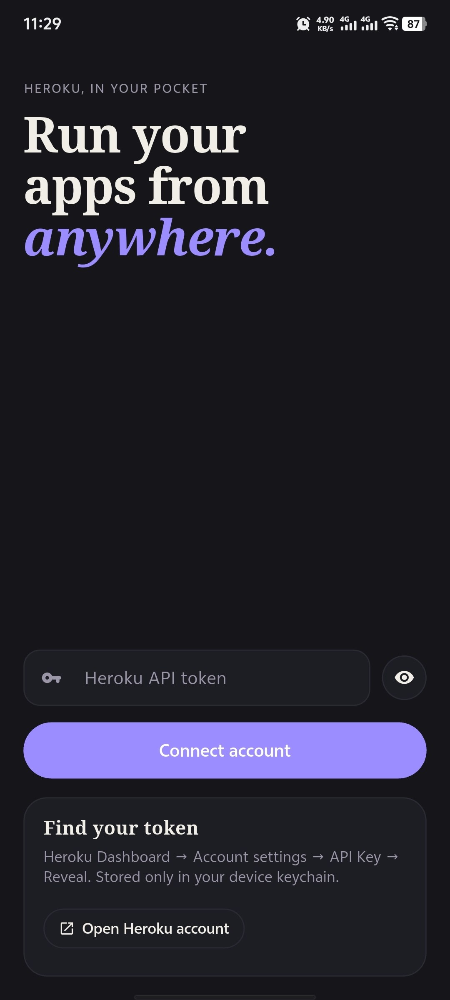
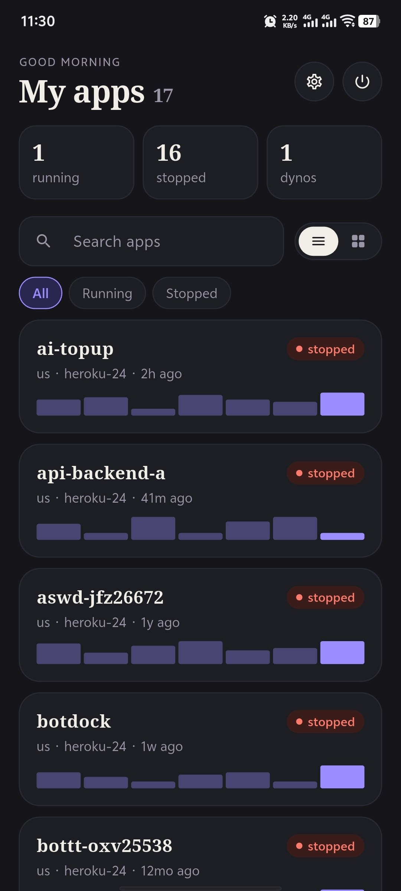
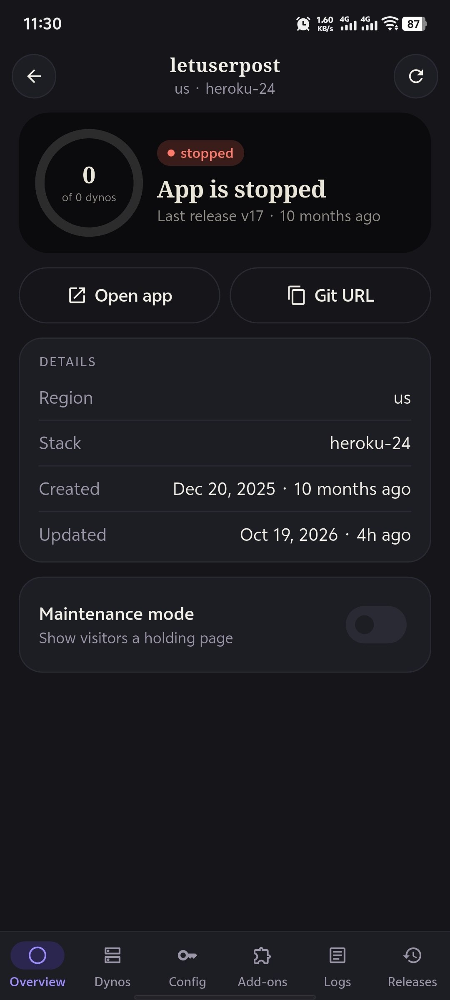
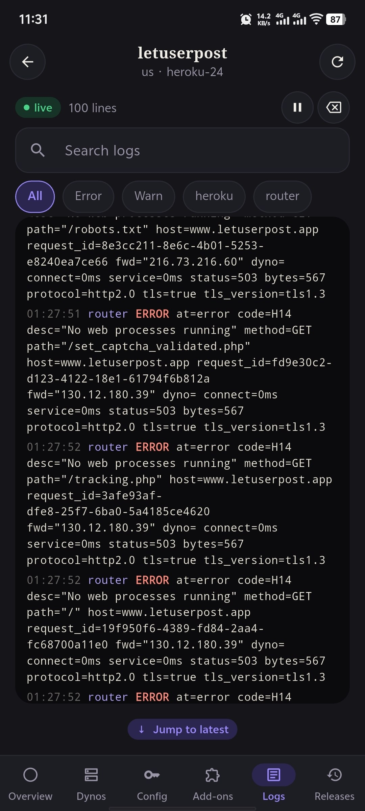
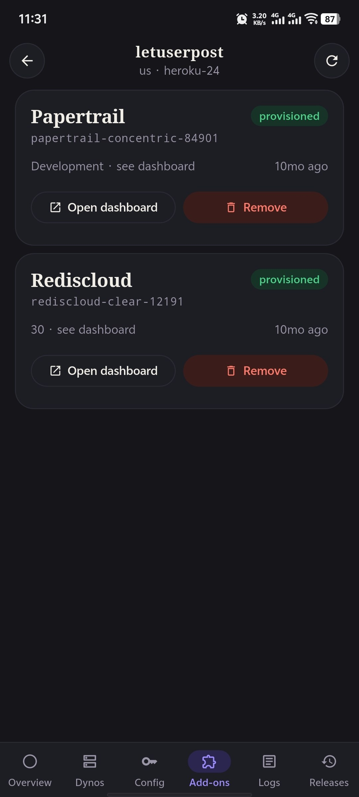
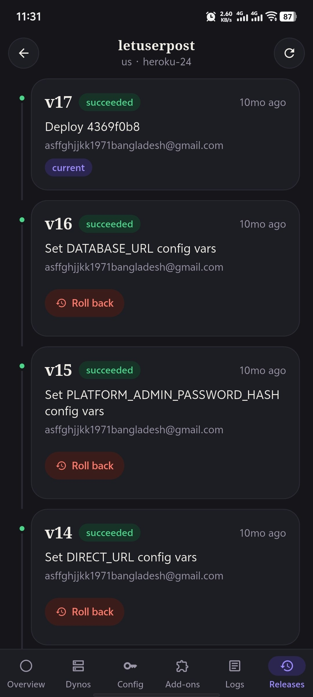
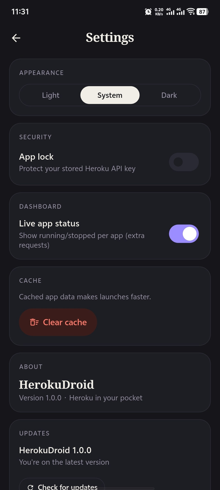

<div align="center">


# HerokuDroid

**Your Heroku apps, in your pocket.**

A native Android client for the [Heroku Platform API](https://devcenter.heroku.com/articles/platform-api-reference) —
real-time logs, dyno scaling, config vars, add-ons and releases, all from your phone.

[](https://flutter.dev)
[](#)
[](#)
[](LICENSE)
[](#contributing)

[Download](#download) · [Features](#features) · [Screenshots](#screenshots) · [Build from source](#build-from-source) · [Contributing](#contributing)

</div>

---

## Screenshots

<div align="center">

| Login | Dashboard | Overview | Live logs |
|:---:|:---:|:---:|:---:|
|  |  |  |  |
| **Add-ons** | **Releases** | **Settings** | |
|  |  |  | |

</div>

---

## Features

- **Real-time log streaming** — tail your Heroku logs live over HTTP, filter by
  dyno or source, pause and clear, with automatic coloring by log level.
- **App dashboard** — every app on your account with status, stack and region;
  search and pull-to-refresh.
- **Dyno management** — scale formation types up or down and restart individual
  process types or all dynos at once.
- **Config vars** — view, add, edit and delete environment variables.
- **Add-ons** — browse attached add-ons and open their dashboards.
- **Releases** — review your release history and roll back to a previous release.
- **Maintenance mode** — toggle an app in and out of maintenance with one tap.
- **App lock** — protect the app with your fingerprint/face or an in-app
  password; it re-locks automatically when you leave.
- **In-app updates** — checks for new versions and points you at the download.
- **Paper design system** — a clean, editorial light/dark theme.

## Download

<div align="center">


[](https://github.com/rjfahad/HerokuDroid/releases/latest)

</div>

Google Play release is **coming soon**. In the meantime, build from source or
grab an APK from the [GitHub releases](https://github.com/rjfahad/HerokuDroid/releases/latest).

You sign in with a **Heroku API key** — there's no separate account to create.
Grab one from **Heroku Dashboard → Account settings → API Key → Reveal**.

## Build from source

**Requirements:** Flutter 3.44+ (Dart 3.9+) and the Android SDK.

```bash
git clone https://github.com/rjfahad/HerokuDroid.git
cd HerokuDroid
flutter pub get
flutter run                  # debug build on a connected device/emulator
```

Common tasks:

```bash
flutter analyze              # lint (flutter_lints)
flutter test                 # unit + widget tests
dart format .                # formatting (not `flutter format`)
flutter build apk --release  # also: --split-per-abi, appbundle --release
```

> Release builds are signed with `android/key.properties` when present and
> otherwise fall back to debug keys, so `flutter run --release` works out of the
> box. The keystore and `key.properties` are gitignored.

## Tech stack

| Layer | Choice |
|---|---|
| Framework | Flutter / Dart |
| State | `provider` (`ChangeNotifier`) |
| Networking | `dio` (with auth + error interceptors) |
| Secure storage | `flutter_secure_storage` |
| Biometrics | `local_auth` |
| Prefs & caching | `shared_preferences` |
| UI | Custom "Paper" theme, `skeletonizer` loading states |
| Extras | `url_launcher`, `package_info_plus`, `intl` |

## Architecture

A three-layer flow, with all dependencies constructed once in `lib/main.dart`
(there is no service locator):

```
presentation/  →  data/repositories/  →  data/services/
   screens,          business logic         HerokuApiService (Dio),
   providers,        + error mapping        SecureStorageService,
   widgets                                  LogStreamService
```

- `HerokuApiService` is the single Dio client. Interceptors inject the API token
  and convert `DioException` into a user-facing `HerokuException`.
- All endpoints live as static methods on `ApiConstants`.
- Log streaming is plain **HTTP streaming** (`POST /log-sessions` →
  `logplex_url` → line-buffered response stream), not a WebSocket.
- Navigation is imperative `Navigator`, with an `AuthCheck` gate in `app.dart`.

## Security & privacy

- Your Heroku API key is stored only in the **device keychain** and sent only to
  `api.heroku.com`. Nothing is sent to the developer.
- The Dio logging interceptor deliberately excludes the `Authorization` header.
- Optional biometric/PIN app lock keeps the stored token behind your device
  credentials.
- No analytics, no ads, no tracking.

## Known limitations

- No log auto-reconnect — reconnect manually if the stream drops.
- Logs are capped at 1000 lines to bound memory use.
- No token refresh; rotating your API key requires re-login.
- Android-centric (the Flutter codebase also targets iOS/web/desktop, but those
  aren't actively maintained).

## Contributing

Contributions are welcome. To get started:

1. Fork the repo and create a branch (`git checkout -b feature/my-change`).
2. Make your change and keep `flutter analyze` and `flutter test` green.
3. Run `dart format .` and open a pull request describing what and why.

Bug reports and feature requests are just as valuable — please
[open an issue](https://github.com/rjfahad/HerokuDroid/issues).

## License

Released under the [MIT License](LICENSE).

---

<div align="center">
<sub>HerokuDroid is an independent, third-party client. It is <b>not affiliated with, endorsed by, or sponsored by Heroku or Salesforce</b>. "Heroku" is a trademark of its respective owner.</sub>
</div>
